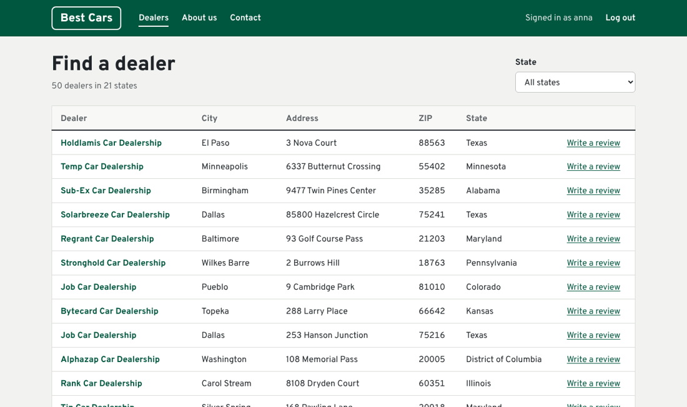
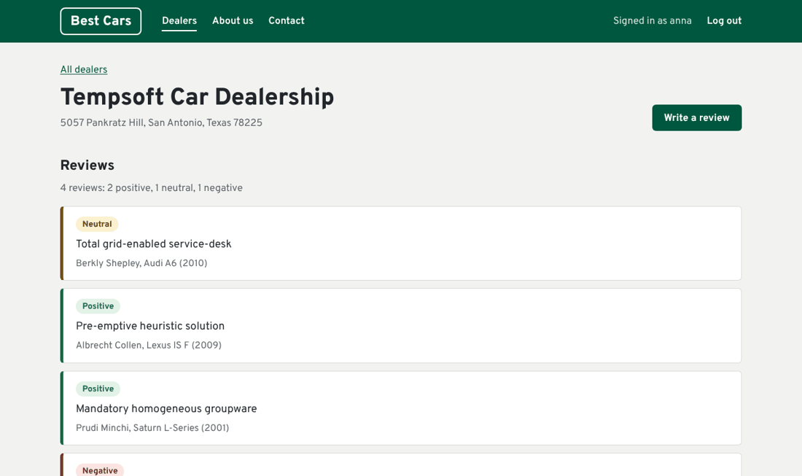
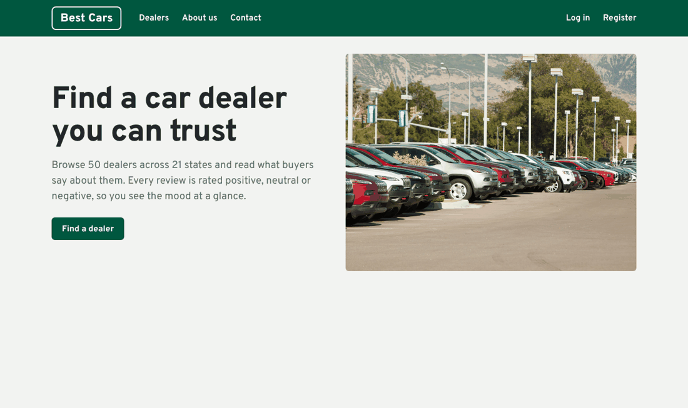
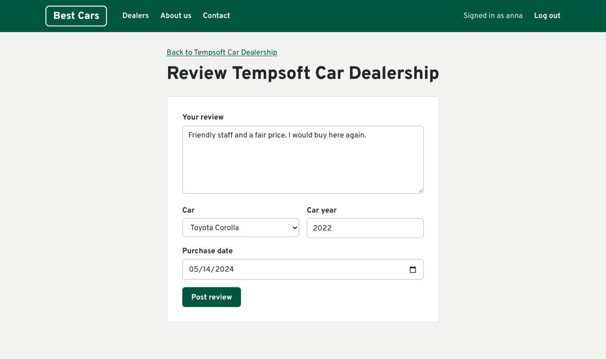
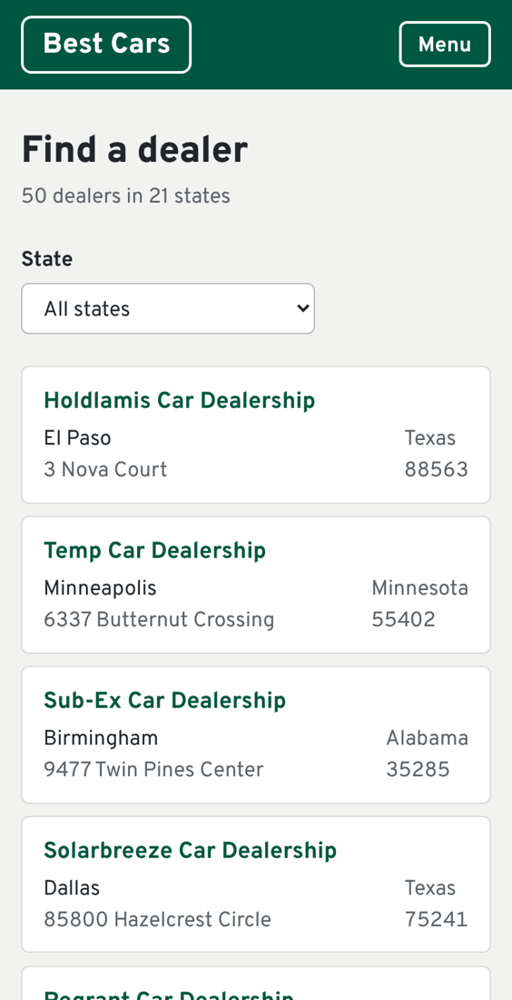
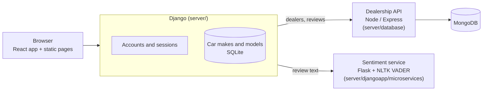

# Best Cars Dealerships

[](https://github.com/AnnaTverdovska/xrwvm-fullstack_developer_capstone/actions/workflows/ci.yml)

A full-stack web app for a (fictional) national car dealership chain. Visitors can browse
dealers and filter them by state; registered users can post reviews, and every review is
automatically rated positive, neutral or negative.

The project started as the capstone of the IBM Full Stack Software Developer certificate,
built on IBM Skills Network's template.

**[Try the live demo](https://annatverdovska.github.io/xrwvm-fullstack_developer_capstone/)**: the same
pages running entirely in your browser, with the sample data. Accounts and reviews you add stay
in your browser, and reviews are rated with the JavaScript version of the same sentiment
analyzer. See [How the demo works](#how-the-demo-works).

| Dealers, filtered by state | A dealer's reviews with their sentiment |
|---|---|
|  |  |

| Home page | Posting a review |
|---|---|
|  |  |



### Design

The look borrows from US highway guide signs, since the dealers are spread across the states:
a green sign bar with white lettering, and quiet greys everywhere else. The typeface is
[Overpass](https://overpassfont.org/), modelled on the lettering of those signs and served from
the site itself, so no fonts are loaded from third parties. Every page works on phones: the
menu folds into a button and the dealer list turns into stacked entries. Reviews show their
sentiment as a coloured edge and a label in words.

The React pages share `server/frontend/src/theme.css`; the static Home, About and Contact pages
use an identical copy in `server/frontend/static/theme.css` (a test checks that they match).

<br clear="right">

## How it fits together



| Part | Tech | What it does |
|---|---|---|
| Frontend (`server/frontend`) | React 18, React Router | Login, registration, dealer list, dealer page, review form |
| Backend (`server/djangoproj`, `server/djangoapp`) | Django 5 | Serves the site, handles accounts, stores car makes and models, connects the services |
| Dealership API (`server/database`) | Node.js, Express, Mongoose, MongoDB | Dealers and reviews, loaded from `data/*.json` on start |
| Sentiment service (`server/djangoapp/microservices`) | Flask, NLTK VADER | Rates a text as positive, neutral or negative |

## Running it locally

You need Python 3.10+, Node.js 20 and [Docker](https://www.docker.com/products/docker-desktop/)
(only for MongoDB). Start each service in its own terminal:

```bash
# 1. Dealership API and MongoDB (http://localhost:3030)
cd server/database
docker compose up --build

# 2. Sentiment service (http://localhost:5050)
cd server/djangoapp/microservices
pip install -r requirements.txt
python app.py

# 3. Build the React app
cd server/frontend
npm ci
npm run build

# 4. Django (http://localhost:8000)
cd server
pip install -r requirements.txt
python manage.py migrate
python manage.py runserver
```

Then open <http://localhost:8000>. To edit car makes and models, create an admin user with
`python manage.py createsuperuser` and go to <http://localhost:8000/admin>.

### Configuration

| Setting | Where | Default |
|---|---|---|
| `backend_url`, `sentiment_analyzer_url` | `server/djangoapp/.env` | `http://localhost:3030`, `http://localhost:5050/` |
| `DJANGO_SECRET_KEY`, `DJANGO_DEBUG`, `DJANGO_ALLOWED_HOSTS`, `DJANGO_CSRF_TRUSTED_ORIGINS` | environment | development values; set them for any real deployment |
| `MONGO_URL`, `PORT` | environment of the dealership API | `mongodb://mongo_db:27017/`, `3030` |

## How the demo works

GitHub Pages can only serve static files, so the demo can't run Django, Express, MongoDB or
Flask. Instead, `npm run build:demo` in `server/frontend` builds the React app in demo mode
(`REACT_APP_DEMO=true`):

- `src/demo/demoApi.js` answers the app's `/djangoapp/...` requests in the browser, with the
  same JSON as the Django views. Dealers and reviews come from `server/database/data`.
- Accounts (with a hashed password) and new reviews are stored in the visitor's `localStorage`;
  nothing is sent to a server.
- Reviews are rated with [vaderSentiment-js](https://github.com/vaderSentiment/vaderSentiment-js),
  the JavaScript port of the VADER analyzer the Flask service uses, with the same thresholds.
- The pages use hash routes (`app/#/dealers`), and the Home, About and Contact pages are copied
  next to the app with their links adjusted.
- A licenses page lists everything the demo distributes: this project's Apache 2.0 license,
  vaderSentiment-js (Apache 2.0, with its NOTICE), Bootstrap (MIT) and the app's libraries.

The `Demo site` workflow builds and publishes it on every push to `main`. The demo code is
loaded separately, so the normal build doesn't include it.

## Tests

Each part has its own tests, and GitHub Actions runs all of them, plus flake8, on every push:

```bash
cd server && python manage.py test djangoapp          # Django views, accounts, cars (17 tests)
cd server/djangoapp/microservices && pytest           # sentiment service (7 tests)
cd server/database && npm ci && npm test              # dealership API routes (8 tests)
cd server/frontend && npm test -- --watchAll=false    # React components, demo API, theme copy (14 tests)
```

None of them need the other services running: the calls between services are replaced with
fakes in the tests.

## Changes to the IBM template

This repository is a modified version of IBM Skills Network's capstone template
(`ibm-developer-skills-network/xrwvm-fullstack_developer_capstone`), licensed under the
Apache License 2.0. All changes were made in 2026 by AnnaTverdovska; the commit history shows
each one in detail. Changed files that allow comments also say so in their first lines.

<details>
<summary>Files changed from the template (31)</summary>

- `README.md`
- `server/database/Dockerfile`
- `server/database/app.js`
- `server/database/dealership.js`
- `server/database/docker-compose.yml`
- `server/database/package.json`
- `server/djangoapp/.env`
- `server/djangoapp/admin.py`
- `server/djangoapp/microservices/Dockerfile`
- `server/djangoapp/microservices/app.py`
- `server/djangoapp/microservices/requirements.txt`
- `server/djangoapp/models.py`
- `server/djangoapp/populate.py`
- `server/djangoapp/restapis.py`
- `server/djangoapp/urls.py`
- `server/djangoapp/views.py`
- `server/djangoproj/settings.py`
- `server/djangoproj/urls.py`
- `server/frontend/.gitignore`
- `server/frontend/package-lock.json`
- `server/frontend/package.json`
- `server/frontend/src/App.js`
- `server/frontend/src/components/Dealers/Dealer.jsx`
- `server/frontend/src/components/Dealers/Dealers.jsx`
- `server/frontend/src/components/Dealers/PostReview.jsx`
- `server/frontend/src/components/Header/Header.jsx`
- `server/frontend/src/components/Login/Login.jsx`
- `server/frontend/src/index.js`
- `server/frontend/static/About.html`
- `server/frontend/static/Home.html`
- `server/requirements.txt`

</details>

<details>
<summary>Files added (28, plus the screenshots in docs/)</summary>

- `.flake8`
- `.github/workflows/ci.yml`
- `.github/workflows/demo.yml`
- `server/database/.gitignore`
- `server/database/app.test.js`
- `server/database/package-lock.json`
- `server/djangoapp/microservices/.gitignore`
- `server/djangoapp/microservices/test_app.py`
- `server/djangoapp/migrations/0001_initial.py`
- `server/djangoapp/migrations/__init__.py`
- `server/djangoapp/tests.py`
- `server/frontend/scripts/build-demo-site.js`
- `server/frontend/src/App.test.js`
- `server/frontend/src/components/Dealers/DealerList.css`
- `server/frontend/src/components/Register/Register.jsx`
- `server/frontend/src/demo/DemoBanner.jsx`
- `server/frontend/src/demo/demoApi.js`
- `server/frontend/src/demo/demoApi.test.js`
- `server/frontend/src/links.js`
- `server/frontend/src/setupTests.js`
- `server/frontend/src/theme.css`
- `server/frontend/src/theme.test.js`
- `server/frontend/static/Contact.html`
- `server/frontend/static/fonts.css`
- `server/frontend/static/fonts/OFL.txt`
- `server/frontend/static/fonts/overpass-latin-wght-normal.woff2`
- `server/frontend/static/nav.js`
- `server/frontend/static/theme.css`

</details>

<details>
<summary>Files removed (21)</summary>

The template's Bootstrap copies, old stylesheets and icon images, replaced by the new design:

- `confirm.png`
- `server/frontend/src/components/Dealers/Dealers.css`
- `server/frontend/src/components/Login/Login.css`
- `server/frontend/src/components/Register/Register.css`
- `server/frontend/src/components/assets/bootstrap.min.css`
- `server/frontend/src/components/assets/close.png`
- `server/frontend/src/components/assets/email.png`
- `server/frontend/src/components/assets/negative.png`
- `server/frontend/src/components/assets/neutral.png`
- `server/frontend/src/components/assets/password`
- `server/frontend/src/components/assets/password.png`
- `server/frontend/src/components/assets/person.png`
- `server/frontend/src/components/assets/positive.png`
- `server/frontend/src/components/assets/reviewbutton.png`
- `server/frontend/src/components/assets/reviewicon.png`
- `server/frontend/src/components/assets/style.css`
- `server/frontend/static/bootstrap.min.css`
- `server/frontend/static/cars.jpeg`
- `server/frontend/static/contactus.png`
- `server/frontend/static/person.png`
- `server/frontend/static/style.css`

</details>

## License

[Apache License 2.0](LICENSE), the license of the original template: Copyright 2020 IBM
Developer Skills Network. The Overpass typeface is included under the SIL Open Font License
([`server/frontend/static/fonts/OFL.txt`](server/frontend/static/fonts/OFL.txt)). "Best Cars" and its staff are fictional; the dealer and review data
is sample data from the template.
