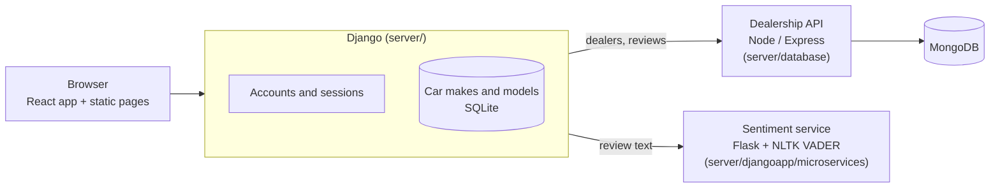

# Best Cars Dealerships

[](https://github.com/AnnaTverdovska/xrwvm-fullstack_developer_capstone/actions/workflows/ci.yml)

A full-stack web app for a (fictional) national car dealership chain. Visitors can browse
dealers and filter them by state; registered users can post reviews, and every review is
automatically rated positive, neutral or negative.

The project started as the capstone of the IBM Full Stack Software Developer certificate,
built on IBM Skills Network's template.

| Dealers, filtered by state | A dealer's reviews with their sentiment |
|---|---|
|  |  |

| Home page | Posting a review |
|---|---|
|  |  |

## How it fits together



| Part | Tech | What it does |
|---|---|---|
| Frontend (`server/frontend`) | React 18, React Router | Login, registration, dealer list, dealer page, review form |
| Backend (`server/djangoproj`, `server/djangoapp`) | Django 5 | Serves the site, handles accounts, stores car makes and models, connects the services |
| Dealership API (`server/database`) | Node.js, Express, Mongoose, MongoDB | Dealers and reviews, loaded from `data/*.json` on start |
| Sentiment service (`server/djangoapp/microservices`) | Flask, NLTK VADER | Rates a text as positive, neutral or negative |

## Running it locally

You need Python 3.10+, Node.js 20 and [Docker](https://www.docker.com/products/docker-desktop/)
(only for MongoDB). Start each service in its own terminal:

```bash
# 1. Dealership API and MongoDB (http://localhost:3030)
cd server/database
docker compose up --build

# 2. Sentiment service (http://localhost:5050)
cd server/djangoapp/microservices
pip install -r requirements.txt
python app.py

# 3. Build the React app
cd server/frontend
npm ci
npm run build

# 4. Django (http://localhost:8000)
cd server
pip install -r requirements.txt
python manage.py migrate
python manage.py runserver
```

Then open <http://localhost:8000>. To edit car makes and models, create an admin user with
`python manage.py createsuperuser` and go to <http://localhost:8000/admin>.

### Configuration

| Setting | Where | Default |
|---|---|---|
| `backend_url`, `sentiment_analyzer_url` | `server/djangoapp/.env` | `http://localhost:3030`, `http://localhost:5050/` |
| `DJANGO_SECRET_KEY`, `DJANGO_DEBUG`, `DJANGO_ALLOWED_HOSTS`, `DJANGO_CSRF_TRUSTED_ORIGINS` | environment | development values; set them for any real deployment |
| `MONGO_URL`, `PORT` | environment of the dealership API | `mongodb://mongo_db:27017/`, `3030` |

## Tests

Each part has its own tests, and GitHub Actions runs all of them, plus flake8, on every push:

```bash
cd server && python manage.py test djangoapp          # Django views, accounts, cars (17 tests)
cd server/djangoapp/microservices && pytest           # sentiment service (7 tests)
cd server/database && npm ci && npm test              # dealership API routes (8 tests)
cd server/frontend && npm test -- --watchAll=false    # React components (7 tests)
```

None of them need the other services running: the calls between services are replaced with
fakes in the tests.

## Changes to the IBM template

This repository is a modified version of IBM Skills Network's capstone template
(`ibm-developer-skills-network/xrwvm-fullstack_developer_capstone`), licensed under the
Apache License 2.0. All changes were made in 2026 by AnnaTverdovska; the commit history shows
each one in detail. Changed files that allow comments also say so in their first lines.

<details>
<summary>Files changed from the template (27)</summary>

- `README.md`
- `server/database/Dockerfile`
- `server/database/app.js`
- `server/database/dealership.js`
- `server/database/docker-compose.yml`
- `server/database/package.json`
- `server/djangoapp/.env`
- `server/djangoapp/admin.py`
- `server/djangoapp/microservices/Dockerfile`
- `server/djangoapp/microservices/app.py`
- `server/djangoapp/microservices/requirements.txt`
- `server/djangoapp/models.py`
- `server/djangoapp/populate.py`
- `server/djangoapp/restapis.py`
- `server/djangoapp/urls.py`
- `server/djangoapp/views.py`
- `server/djangoproj/settings.py`
- `server/djangoproj/urls.py`
- `server/frontend/package-lock.json`
- `server/frontend/src/App.js`
- `server/frontend/src/components/Dealers/Dealer.jsx`
- `server/frontend/src/components/Dealers/Dealers.jsx`
- `server/frontend/src/components/Dealers/PostReview.jsx`
- `server/frontend/src/components/Header/Header.jsx`
- `server/frontend/static/About.html`
- `server/frontend/static/Home.html`
- `server/requirements.txt`

</details>

<details>
<summary>Files added (14, plus the screenshots in docs/)</summary>

- `.flake8`
- `.github/workflows/ci.yml`
- `server/database/.gitignore`
- `server/database/app.test.js`
- `server/database/package-lock.json`
- `server/djangoapp/microservices/.gitignore`
- `server/djangoapp/microservices/test_app.py`
- `server/djangoapp/migrations/0001_initial.py`
- `server/djangoapp/migrations/__init__.py`
- `server/djangoapp/tests.py`
- `server/frontend/src/App.test.js`
- `server/frontend/src/components/Register/Register.jsx`
- `server/frontend/src/setupTests.js`
- `server/frontend/static/Contact.html`

</details>

## License

[Apache License 2.0](LICENSE), the license of the original template: Copyright 2020 IBM
Developer Skills Network. "Best Cars" and its staff are fictional; the dealer and review data
is sample data from the template.
